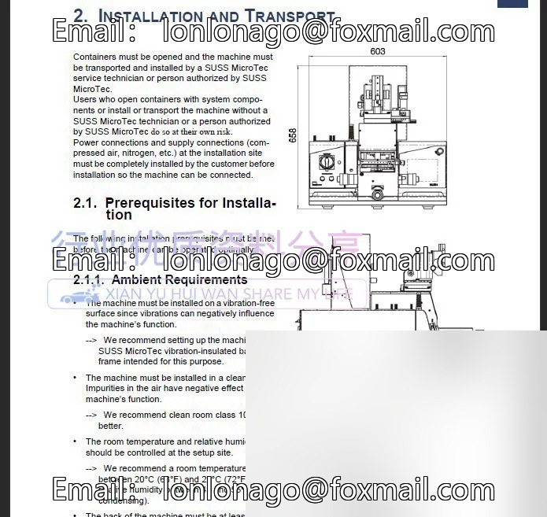
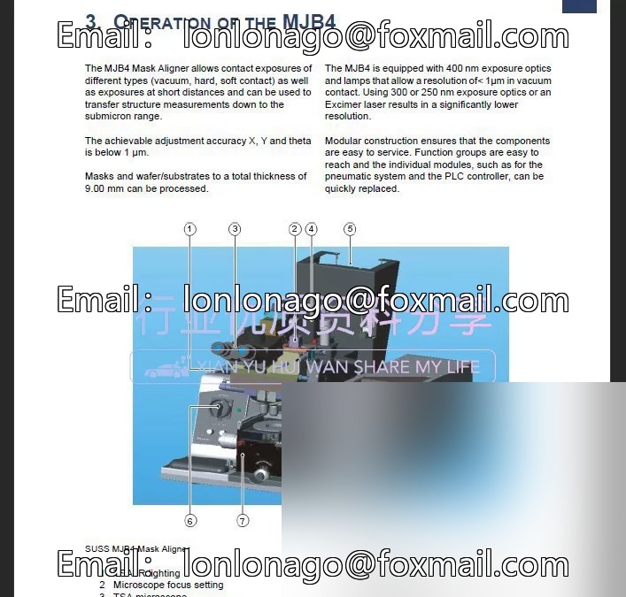
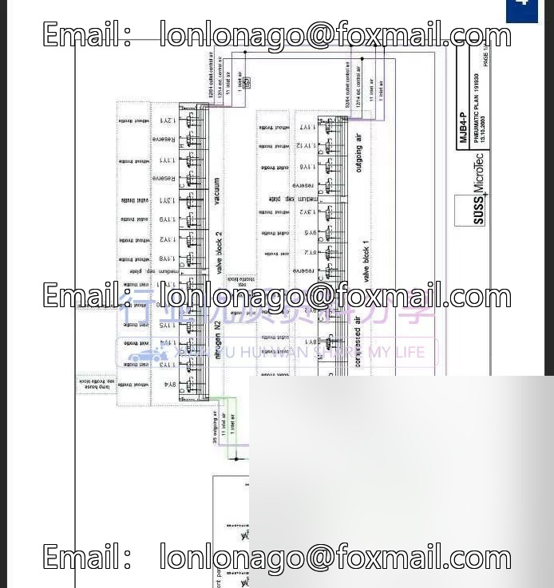
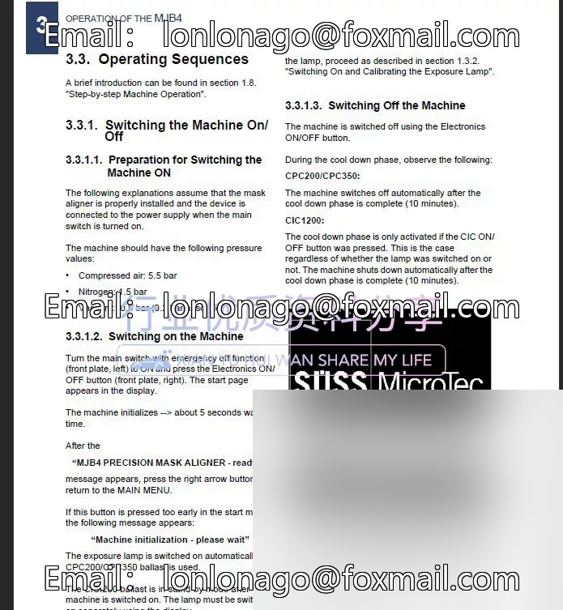

# #User manual for SUSS Sust MJB-4 mask aligning lithography machine equipment from Germany

## Body

# Materials on the German SUSS SUSS MJB-4 mask alignment lithography machine equipment user manual technical data, totaling 160 pages, including device structure descriptions and reference value of detailed circuit diagrams.

Capture and send the electronic original directly! The following images include screenshots of the file portion. Please confirm before placing the order! Due to the replicable nature of electronic documentation Therefore, are allowed after purchase! Thanks for understanding!

For personal learning and reference use only.

The user manual covers German SUSS Suss MJB-4 mask aligner technical materials, spanning 160 pages and including device structure descriptions, detailed circuit references and installation and transport requirements.

<!-- AI_ENRICHED -->

## Images

## Payment

Here is a pay link on Stripe ( https://buy.stripe.com/3cs8yP7sY87d0vu9AB ). Please contact me lonlonago@foxmail.com after funding $89, and I will send you a complete data files , thank you!

